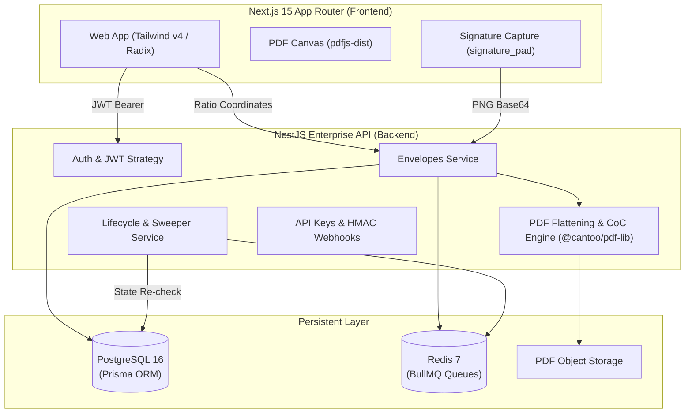

# SignDesk — E-Signature & Approval Workflow SaaS

> **Legally-recognisable electronic signatures & approval workflows for Bangladeshi commerce under the ICT Act 2006.**

[](https://github.com/razikuljoni/signdesk/actions)
[](https://opensource.org/licenses/MIT)
[](https://nodejs.org/)
[](https://www.postgresql.org/)
[](https://redis.io/)

---

## 1. Product Case Study & Executive Summary

### The Problem
Bangladeshi SMEs execute hundreds of thousands of commercial agreements annually (NDAs, vendor purchase orders, lease contracts, employment offers). DocuSign and Adobe Sign fail this market for three distinct reasons:
1. **Pricing & Payment Barrier:** International pricing in USD requiring international credit cards (prohibitive for 90%+ of local SMEs).
2. **Evidentiary Misalignment:** Lack of local statutory grounding under the **Bangladesh Information and Communication Technology (ICT) Act 2006**.
3. **Signer Friction:** Complex account-creation requirements that cause high signer drop-off rates on mobile devices.

### The Solution: SignDesk
SignDesk is a specialized, zero-cost-tier compliant e-signature platform built specifically for Bangladesh commerce:
- **No-Account Signer Journey:** Signers receive cryptographic email invitations with 256-bit single-use tokens; they can review plain-language AI summaries (powered by Gemini API) and execute agreements on desktop or mobile in under 60 seconds.
- **Evidentiary Certificate of Completion:** Flattens all signatures and appends an evidentiary audit certificate with Newsreader serif typography, GPS/IP geolocation, UTC atomic timestamps, and SHA-256 Merkle hash chaining.
- **Bangladeshi Heritage Design:** Warm paper (`#FAF7F1`), Deep Pine (`#0C2E29`), Wax Seal Vermilion (`#B3402A`), and Verified Brass (`#C9A227`).

---

## 2. Cryptographic Proof: How Do You Prove This PDF Wasn't Altered?

> **The Evidentiary Proof (in one paragraph):**  
> At the moment of document ingestion, SignDesk computes a recursive SHA-256 genesis hash of the source PDF. Throughout the signing ceremony, every discrete action (invitation dispatch, disclosure consent, IP capture, field entry, signature attestation) is immutably appended to a parent-hashed Merkle audit chain (`eventHash = SHA256(prevHash + eventType + payload + timestamp)`). Upon the final signature, all fields are flattened server-side into the PDF and a formal Certificate of Completion is appended *prior* to computing the final checksum `finalHash`. Any subsequent byte alteration—even a single flipped bit in an invoice figure or date—instantly breaks the SHA-256 digest comparison against `finalHash`, while any retroactive modification of an audit record corrupts the linear hash chain, enabling any Bangladeshi court or tribunal to detect tampering deterministically under Section 7 of the ICT Act 2006.

---

## 3. Architecture & Data Flow



---

## 4. Key Architectural Decisions & Trade-Offs

| Decision | Selected Choice | Rationale & Trade-Off |
| :--- | :--- | :--- |
| **Field Geometry** | **Normalized Ratios (0.0 to 1.0)** | Pixels corrupt across zoom levels and mobile viewports. Storing dimensionless ratios `(xRatio, yRatio, wRatio, hRatio)` guarantees mathematically identical placement at 50% or 200% zoom. |
| **Coordinate Y-Flip** | **Bottom-Left Inversion on Flatten** | HTML Canvas origin is top-left `(0,0)` with downward Y; PDF specification origin is bottom-left with upward Y. Geometry helper converts `pdfY = height - (yRatio * height) - fieldHeight`. |
| **PDF Finalization** | **Late Server-Side Flattening** | Never flatten or append certificates early; intermediate drafts remain mutable until the final designated signer completes their intent act. |
| **Worker State Guard** | **Mandatory Worker State Re-check** | BullMQ is at-least-once. Lifecycle workers reload the envelope and recipient state immediately prior to dispatch. If a signer executed early, reminders are suppressed. |
| **Free-Tier Protection** | **Resend 100/day & 5 Envelopes/mo Cap** | Protects zero-cost operating expenditure. In-app meters show exact remaining allowances (`"78/100 emails left today"`). |

---

## 5. Completed User Flows (F1 through F5)

- **F1 (Upload & Field Placement):** Sender uploads multi-page contract, places 9 standard field types (Signature, Initials, Date Signed, Text, Name, Email, Company, Title, Checkbox), assigns color-coded signers with sequential order handles.
- **F2 (Sequential Signing Ceremony):** Signer 1 receives magic link -> reviews AI clause summary -> reviews document -> signs via Draw/Type/Upload -> submits intent -> Signer 2 is automatically unlocked and notified.
- **F3 (Completion & Verification):** PDF fields flattened -> Certificate of Completion generated with brass seal and hash chain -> final PDF hashed -> `GET /envelopes/:id/verify` reports "Verified".
- **F4 (Templates):** 6 starter BD SME contract templates (NDA, MSA, Offer Letter, Freelancer, Invoice, Rental) -> 1-click instantiate with 2 recipients without touching canvas.
- **F5 (Team, API & Webhooks):** RBAC enforced (Admins manage team, Viewers get 403 on send/void), REST v1 API with `Idempotency-Key`, HMAC-SHA256 webhooks with 5-minute replay tolerance.

---

## 6. What Breaks at Scale & What We'd Do Differently

1. **PDF Rendering Memory Pressure:** `pdf-lib` loads the entire uncompressed PDF into Node.js buffer memory. For 500+ page filings, this risks Node.js OOM. At scale, offload rendering to an asynchronous Rust worker via WASM.
2. **Qualified Electronic Signatures (QES):** SignDesk provides legally admissible Simple Electronic Signatures (SES). For banking and government contracts requiring Qualified Electronic Signatures, integrate licensed Bangladeshi CAs (BCC-CA, Dohatec, Mango CA) using PKCS#7 / PAdES X.509 cryptographic hardware tokens.
3. **Database Partitioning for Audit Trails:** Chained audit event records grow linearly. At millions of envelopes, partition the `AuditEvent` table by `envelopeId` hash and archive completed chains to cold S3 Glacier storage with Merkle root pinning.

---

## 7. Quick Start & Verification

### Running with Docker
```bash
docker compose up -d
```
- Web Application: `http://localhost:3000`
- API Backend: `http://localhost:4000`
- MailHog SMTP UI: `http://localhost:8025`

### Running Natively
```bash
# 1. Install dependencies
pnpm install

# 2. Build shared workspace
pnpm --filter @signdesk/shared build

# 3. Run all unit & integration tests (31 tests across 9 suites)
pnpm test

# 4. Build production web bundle
pnpm --filter @signdesk/web build
```

### Seed Demo Credentials
- **Email:** `demo@signdesk.bd`
- **Password:** `SignDesk2026!`
- **Workspace:** `Apex Commerce BD`
