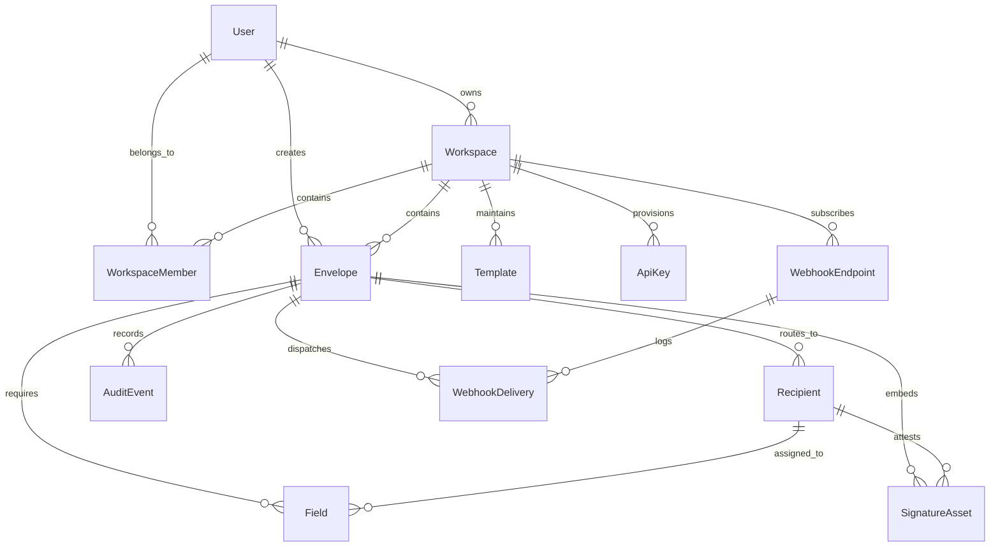
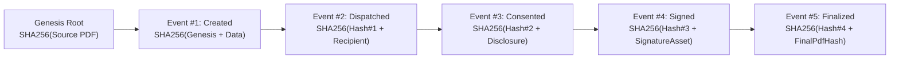
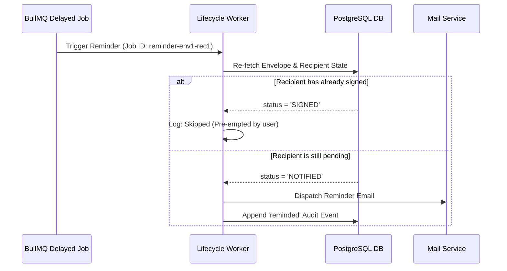

# SignDesk Technical Architecture Documentation

SignDesk is designed as a modular, high-reliability electronic signature platform tailored for the legal and commercial requirements of Bangladesh under the **Information and Communication Technology (ICT) Act 2006**.

---

## 1. Monorepo Topology

```text
SignDesk Monorepo
├── apps/
│   ├── web/                     # Next.js 15 App Router Frontend
│   │   ├── src/app/             # Route handlers & React 19 pages
│   │   │   ├── dashboard/       # Sender dashboard & activity metrics
│   │   │   ├── documents/       # Documents repository & detail ledger
│   │   │   ├── envelopes/       # New upload & 3-zone prepare canvas
│   │   │   ├── sign/[token]/    # Signer ceremony portal & state screens
│   │   │   ├── templates/       # 6 BD SME starter contracts & use flows
│   │   │   └── settings/        # Profile, Team, Workspace, Billing, Dev
│   │   └── src/components/ui/   # shadcn/Radix components with Warm Paper theme
│   │
│   └── api/                     # NestJS Enterprise Backend
│       ├── prisma/              # Prisma schema & PostgreSQL migrations
│       └── src/
│           ├── auth/            # JWT authentication & password hashing
│           ├── envelopes/       # Envelope lifecycle, PDF service & CoC generator
│           ├── signing/         # Public signer portal & Gemini summarizer
│           ├── templates/       # Document templates engine
│           ├── lifecycle/       # BullMQ delayed jobs & hourly sweeper
│           ├── developer/       # REST v1 API, API keys & HMAC webhooks
│           └── mail/            # Transactional SMTP & Resend quota tracker
│
├── packages/
│   └── shared/                  # Common library (TypeScript)
│       ├── src/geometry.ts      # Normalized ratio <-> PDF points converter
│       ├── src/schemas.ts       # Shared Zod validation schemas
│       ├── src/enums.ts         # Status, role, and event enumerations
│       └── src/tokens.ts        # Design tokens (Pine, Seal, Brass, Paper)
│
└── docs/                        # Production & compliance guides
```

---

## 2. Database Entity-Relationship Diagram (ERD)



---

## 3. Normalized Ratio Coordinate System & Y-Flip

### The Zoom & Responsive Problem
Storing coordinates in screen pixels (`px`) causes field drift and misalignment when users view PDFs on different monitor resolutions, mobile screens, or zoom levels (50% to 200%).

### The Ratio Solution
SignDesk stores all field geometries as dimensionless float ratios between `0.0` and `1.0`:
$$\text{xRatio} = \frac{x_{\text{canvas}}}{W_{\text{canvas}}}, \quad \text{yRatio} = \frac{y_{\text{canvas}}}{H_{\text{canvas}}}$$
$$\text{wRatio} = \frac{W_{\text{field}}}{W_{\text{canvas}}}, \quad \text{hRatio} = \frac{H_{\text{field}}}{H_{\text{canvas}}}$$

### The PDF Y-Flip
HTML Canvas coordinates originate at **top-left** $(0,0)$ with $Y$ increasing downwards.
PDF (PostScript) coordinates originate at **bottom-left** $(0,0)$ with $Y$ increasing upwards.

When rendering fields server-side with `@cantoo/pdf-lib`, the coordinates are converted via:

```typescript
export function ratioToPdfPoints(
  ratio: FieldRatioGeometry,
  pdfPageWidth: number,
  pdfPageHeight: number
): PdfPointGeometry {
  const width = ratio.wRatio * pdfPageWidth;
  const height = ratio.hRatio * pdfPageHeight;
  const x = ratio.xRatio * pdfPageWidth;
  // Invert Y coordinate from top-left to bottom-left:
  const y = pdfPageHeight - (ratio.yRatio * pdfPageHeight) - height;

  return { x, y, width, height };
}
```

---

## 4. Cryptographic Merkle Hash Chaining

To ensure legal admissibility under Section 7 and Section 8 of the Bangladesh ICT Act 2006, SignDesk enforces an immutable, append-only hash chain:



### Hash Computation Formula
Every audit record stores:
- `prevHash`: SHA-256 hash of the immediately preceding event (genesis = `originalHash`).
- `eventHash`: SHA-256 computed over `prevHash + actor + action + timestampUtc + payload`.

If any historical record is deleted, updated, or reordered in the database, the hash chain continuity breaks detectably. The `/envelopes/:id/verify` endpoint verifies this continuity recursively.

---

## 5. Server-Side PDF Flattening & Certificate of Completion

PDF finalization occurs strictly upon the intent act of the final designated signatory:

1. **Load Source PDF:** Source bytes loaded into `@cantoo/pdf-lib`.
2. **Flatten Visual Elements:**
   - Signatures and initials embedded as transparent PNG images via `page.drawImage`.
   - Dynamic Caveat font cursive vector rendering used for typed signatures.
   - Text, dates, and checkboxes flattened directly into vector layers.
3. **Generate Certificate of Completion (CoC):**
   - Headings rendered in Newsreader serif style.
   - Deep Pine `#0C2E29` and Verified Brass `#C9A227` framing.
   - Table of signatory IP addresses, geolocations, timestamps, and authentication mechanisms.
   - Merkle hash chain audit summary table.
   - ICT Act 2006 statutory compliance disclosure.
4. **Append Certificate:** CoC page appended to the end of the document.
5. **Final Checksum:** Complete byte array hashed via SHA-256 to produce `finalHash`.

---

## 6. BullMQ Lifecycle Queues & Worker State Re-Check

BullMQ is an at-least-once queue. Network retries or server reboots can cause duplicate job executions.

### State Re-Check Guard
Before any lifecycle action (reminding signers, warning of expiry, or marking expired) is executed, the worker re-queries PostgreSQL within a database transaction:
- If `envelope.status !== 'WAITING'`, the job terminates immediately with zero side-effects.
- If `recipient.status === 'SIGNED'`, reminder emails are suppressed.


